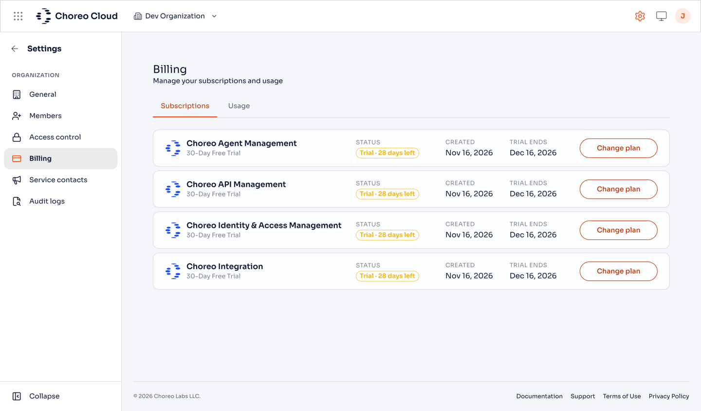
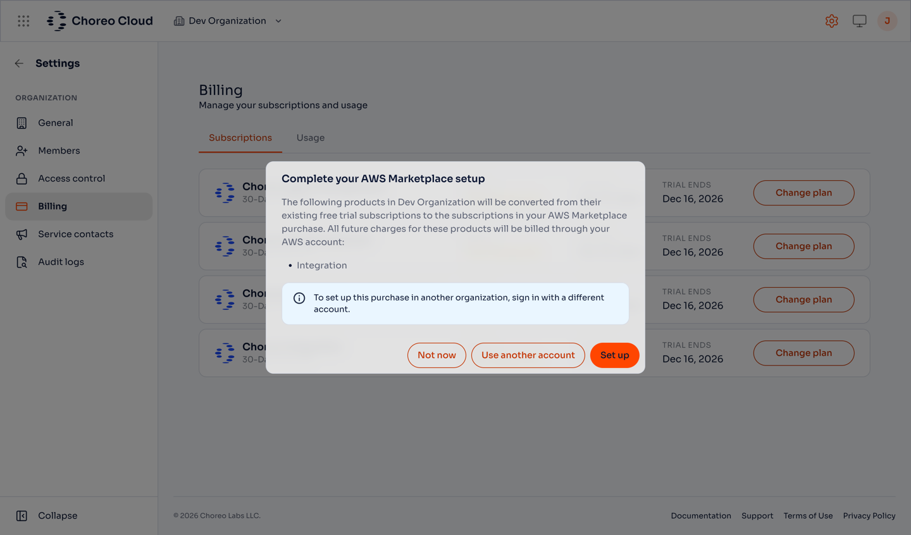
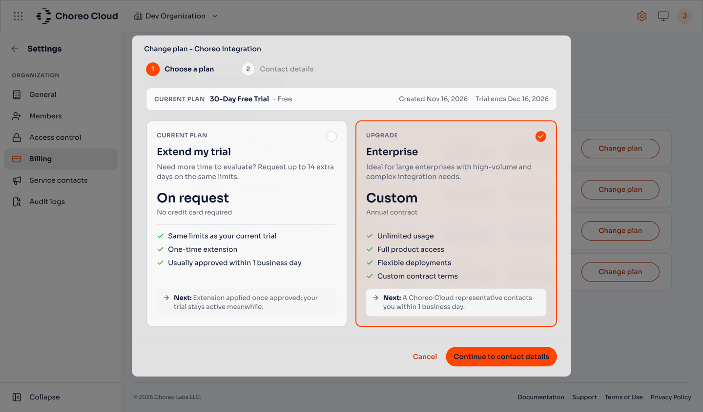
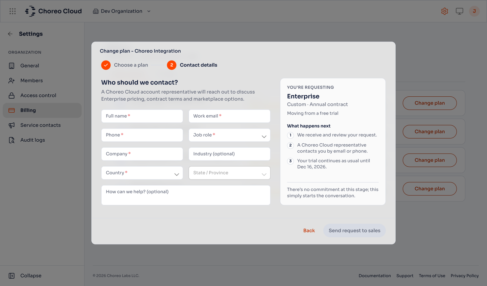
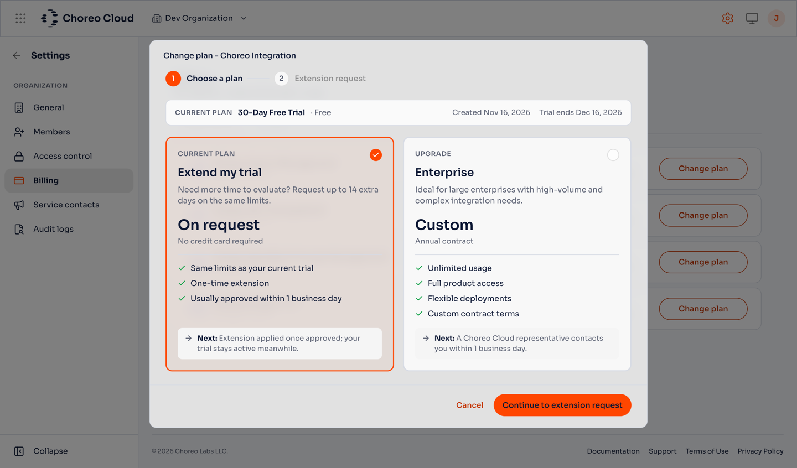
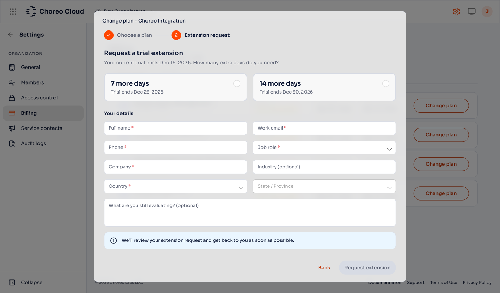

Choreo Cloud Enterprise gives your organization the full capabilities of each service, on an annual contract. You can subscribe through AWS Marketplace or directly with Choreo Labs. Every service also comes with a 30-day free trial, so you can evaluate it before you subscribe. This article explains how subscriptions work and walks you through each step.

## How subscriptions work

Each service in your organization has its own subscription. The subscription sets the features and limits that apply to the service. Services are subscribed to and billed separately, so you can use only the selected services.

Every service offers two plans:

| Plan | What it is | How you get it |
| --- | --- | --- |
| **Enterprise** | A paid subscription with an annual contract. | Through [AWS Marketplace](#subscribe-through-aws-marketplace), or [directly with Choreo Labs](#request-a-direct-enterprise-subscription). |
| **Trial** | Free for 30 days. No credit card required. | Starts automatically. See [Your free trial](#your-free-trial). |

Features and limits in each plan differ by service. See each service's documentation for details.

### Who can manage billing

Members of the organization's **Admin** group can open the **Billing** page, contact sales, request a trial extension, and complete an AWS Marketplace setup. See [Access control](./access-control.mdx).

### Find your subscriptions

1. Sign in to the [Choreo Cloud console](https://console.cloud.choreolabs.com).
2. In the top bar, select **Settings**, then under **Organization**, select **Billing**.
3. Select the **Subscriptions** tab.

Each service has a tile that shows its plan, its status, when it was created, and when the current period or trial ends. Select a tile to see its details.

The **Usage** tab shows how much of each plan's limits your organization uses.

## Subscribe to Enterprise

You can subscribe to Enterprise in two ways:

| | AWS Marketplace | Direct with Choreo Labs |
| --- | --- | --- |
| **Who bills you** | AWS, on your AWS bill. | Choreo Labs, by invoice. |
| **Best for** | Organizations that buy software through AWS, or want to use their AWS commitments. | Organizations that want a contract and invoices from Choreo Labs. |
| **How to start** | Buy Choreo Cloud on AWS Marketplace, then link it to your organization. | Send a request from the console. A Choreo Cloud representative contacts you. |

If you're on a trial, your data and resources stay where they are when you subscribe.

### Subscribe through AWS Marketplace

Choreo Cloud has a single AWS Marketplace listing. One purchase covers the services included in the offer you buy.

#### Before you begin

- An AWS account with permission to buy from AWS Marketplace.
- Membership in the **Admin** group of the Choreo Cloud organization you want to set up. If you don't have an organization yet, you can create one during setup.

#### Buy and set up

1. In AWS Marketplace, open the **Choreo Cloud** listing and select **View purchase options**.
2. Choose your offer and contract terms, then complete the purchase.
3. Select **Set up your account**. AWS Marketplace sends you to Choreo Cloud.
4. Sign in to Choreo Cloud, or sign up if you don't have an account. See [Sign up and create your organization](../get-started/sign-up.mdx).
5. The console opens **Complete your AWS Marketplace setup**. It shows what the purchase does in your organization, for each service. For example, it upgrades a service from its trial to Enterprise and moves its billing to AWS Marketplace.

   

6. Select the action the dialog offers, such as **Upgrade**, **Set up**, or **Link to** *your organization*. To set the purchase up in a different organization, select **Use another account** and sign in with an account in that organization.

The subscription activates once AWS confirms the purchase. Check the **Subscriptions** tab to see the new plan.

#### If setup doesn't finish

| Message | What to do |
| --- | --- |
| "Only an organization admin can complete the AWS Marketplace setup." | Ask an admin of the organization to select **Set up your account** in AWS Marketplace and finish the setup. |
| "This AWS Marketplace purchase is already set up in another organization." | Each purchase belongs to one organization. Sign in with an account in that organization. |
| "We couldn't find this AWS Marketplace purchase." | Go back to AWS Marketplace and select **Set up your account** again. |
| "This AWS Marketplace purchase has expired or been cancelled." | Check the purchase in your AWS account. If it's active, contact [Choreo Cloud support](../reference/support.mdx). |
| "*Organization* is already on *service* with another billing method." | The service already has a direct Choreo Cloud subscription. Select **Contact sales** in the dialog to move it to AWS Marketplace. |
| "*Service* is suspended in *organization*." | Contact [Choreo Cloud support](../reference/support.mdx) to resolve the suspension, then set up the purchase. |

#### Billing through AWS

AWS bills you on your AWS bill, under the terms of your AWS Marketplace contract. To change or cancel the contract, use AWS Marketplace. For questions about a Choreo Cloud service, contact [Choreo Cloud support](../reference/support.mdx).

### Request a direct Enterprise subscription

If you'd rather buy from Choreo Labs, send a request from the console. A Choreo Cloud representative contacts you to discuss pricing, contract terms, and anything else you need.

1. Go to **Settings** > **Billing**, and select the **Subscriptions** tab.
2. On the service's tile, select **Change plan**. If the tile shows **Contact us** instead, select it and go to step 4.
3. Select **Enterprise**, then select **Continue to contact details**.

   

4. Fill in your details. Under **How can we help?**, add anything useful, such as expected usage or your target go-live date.
5. Select **Send request to sales**.

   

A Choreo Cloud representative usually contacts you by email or phone within one business day. Sending a request doesn't commit you to anything, and your trial continues as normal while you talk. Once you sign the contract, Choreo Labs moves the service to Enterprise and sends invoices to your organization's billing contacts.

## Your free trial

Every service comes with a 30-day free trial, with no credit card required.

- **When it starts.** The trial starts when you create your organization, and covers every service. All services share the same trial period, so they all end on the same day.
- **What you get.** The trial's features and limits. Each service's documentation lists them.
- **Before it ends.** Three days before the trial ends, Choreo Labs emails your organization's owner a reminder for each service. The **Subscriptions** tab also shows the end date.
- **When it ends.** The service is suspended, and Choreo Labs emails your organization's owner to say so. You can't use the service until you subscribe to Enterprise or extend the trial. There is no grace period.
- **Your data.** Choreo Labs keeps your data for one month after the trial ends. To keep it, subscribe to Enterprise within that month, or extend your trial within 14 days after it ends.

### Extend your trial

If you need more time to evaluate a service, you can ask for up to 14 extra days on the same limits. You can extend each service's trial once. An extension applies only to the service you request it for, so that service's trial ends later than the others. You can ask before the trial ends, or within 14 days after it has ended.

1. Go to **Settings** > **Billing**, and select the **Subscriptions** tab.
2. On the service's tile, select **Change plan**.
3. Select **Extend my trial**, then select **Continue to extension request**.

   

4. Choose **7 more days** or **14 more days**.
5. Fill in your details. Optionally, tell us what you're still evaluating.
6. Select **Request extension**.

   

Choreo Labs usually approves an extension within one business day, and emails you when it does.

- If your trial is still running, it stays active while you wait. The extra days are added to its end date.
- If your trial has ended, the service resumes once the extension is approved. The extra days count from the day it's approved.

## Manage your subscription

### Set who receives billing notices

Billing contacts receive invoices, payment notices, and subscription changes. Your organization always has at least one billing contact.

1. In the top bar, select **Settings**, then under **Organization**, select **Service contacts**.
2. Select the **Billing** tab, and add or edit contacts.

See [Manage service contacts](./manage-service-contacts.mdx).

### Change or cancel an Enterprise subscription

- **AWS Marketplace.** Change or cancel your contract in AWS Marketplace.
- **Direct with Choreo Labs.** Contact your Choreo Labs account team or [Choreo Cloud support](../reference/support.mdx).

### Ask about a bill

Contact [Choreo Cloud support](../reference/support.mdx). Include your Organization Unit ID, the service, and what you need. To find your Organization Unit ID, see [View organization details](./view-organization-details.mdx).

## Next steps

- [Manage service contacts](./manage-service-contacts.mdx)
- [Get support](../reference/support.mdx)
